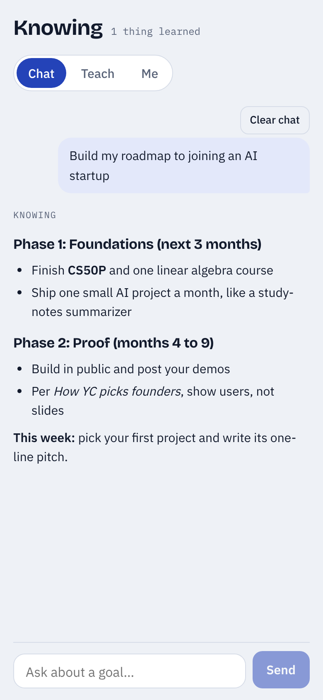
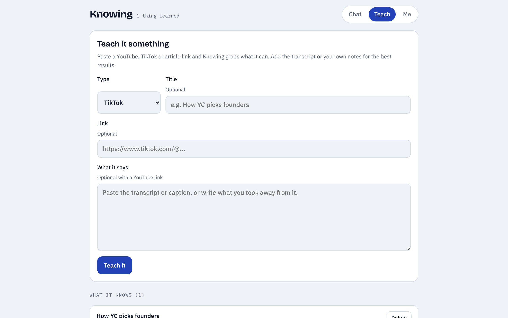

<div align="center">


# Knowing

**A personal goal coach you teach with videos, TikToks and notes.**

Ask an AI about a goal and you get generic tips. Knowing answers from *your* profile and *everything you've taught it*, and turns that into a concrete roadmap.

[](https://github.com/aidensadvakas1-lab/knowing/actions/workflows/ci.yml)


[](LICENSE)

</div>

<p align="center">
  
  &nbsp;&nbsp;
  
</p>

## Features

| | |
|---|---|
| **Chat** | Ask about a goal. Answers stream in, cite the items you taught, and end with a clear next step. |
| **Teach** | Paste a link. Knowing pulls the **YouTube transcript**, the **TikTok caption**, or an **article's text** automatically, then saves 3 to 5 key takeaways and tags. Or paste your own notes. |
| **Me** | Your starting point: where you are now, your goal, skills, weekly time. Every answer starts here. |
| **Backup** | Download everything as one file and restore it on another device. |
| **Phone and desktop** | Mobile-first layout, safe-area aware, installable to the home screen. |
| **Private by default** | Your data stays in your browser. The API key stays on the server. Optional password lock. |

## Quick start

You need [Node.js 22](https://nodejs.org) and an [Anthropic API key](https://console.anthropic.com/settings/keys).

```bash
git clone https://github.com/aidensadvakas1-lab/knowing.git
cd knowing
npm install
cp .env.example .env.local     # paste your ANTHROPIC_API_KEY into it
npm run dev                    # open http://localhost:3000
```

## Deploy (free, about 5 minutes)

1. Go to [vercel.com/new](https://vercel.com/new) and import this repository.
2. Under **Environment Variables**, add:
   - `ANTHROPIC_API_KEY`: your key from the Anthropic Console.
   - `APP_PASSWORD`: any password. Strongly recommended, so strangers who find your URL can't spend your credits.
3. Click **Deploy**. Open the URL on your phone and choose *Add to Home Screen*.

Any Node host that runs Next.js works too (Netlify, Railway, Render, Fly.io).

## Configuration

| Variable | Required | Default | What it does |
|---|---|---|---|
| `ANTHROPIC_API_KEY` | Yes | | Lets the server call Claude. |
| `APP_PASSWORD` | Recommended | *(none)* | When set, the app asks for it once per device before chatting or teaching. |
| `KNOWING_CHAT_MODEL` | No | `claude-opus-5-5` | Model that writes coaching answers. |
| `KNOWING_EXTRACT_MODEL` | No | `claude-haiku-5-5` | Fast model that pulls takeaways out of what you teach. |

## How it works

```
Browser (localStorage)                         Server (Next.js API routes)
┌───────────────────────────┐                 ┌──────────────────────────────────────┐
│ Me      → profile         │  POST /api/chat │ validate → build system prompt        │
│ Teach   → items           │ ──────────────▶ │ → Claude (streaming) → NDJSON stream   │
│ Chat    → history         │                 │                                        │
│                           │ POST /api/learn │ validate → fetch link text            │
│                           │ ──────────────▶ │   (YouTube / TikTok / article)         │
│                           │                 │ → Claude (structured JSON) → takeaways │
└───────────────────────────┘                 └──────────────────────────────────────┘
```

More detail in [docs/ARCHITECTURE.md](docs/ARCHITECTURE.md).

## Project structure

```
app/
  api/chat/route.ts      Streaming coaching answers
  api/learn/route.ts     Fetch a link's text and extract takeaways
  api/health/route.ts    Is the server configured? Is a password needed?
  page.tsx               Tabs and layout
components/              ChatView, TeachView, MeView, Notice
hooks/useKnowing.ts      App state, saved to localStorage
lib/
  prompt.ts              System and extraction prompts (pure, tested)
  fetch-source.ts        YouTube transcript, TikTok caption, article text
  sources.ts             Link parsing and private-address blocking
  validate.ts            zod schemas for every request body
  markdown.ts            Safe Markdown renderer for answers
  storage.ts             localStorage, backup and restore
  chat-stream.ts         NDJSON stream protocol
  server.ts              Anthropic client, password check, error mapping
tests/                   Vitest unit tests
```

## Scripts

| Command | What it does |
|---|---|
| `npm run dev` | Start the dev server |
| `npm run build` | Production build |
| `npm test` | Run unit tests |
| `npm run typecheck` | TypeScript strict check |
| `npm run check` | All of the above, same as CI |

## Limits worth knowing

- **TikTok:** TikTok doesn't publish spoken transcripts, so Knowing gets the caption. Paste what the creator says for better advice.
- **YouTube:** Works for videos with captions. If YouTube blocks the server, paste the transcript instead.
- **Sync:** Data lives on each device. Use **Me → Backup** to move it between phone and computer.

## Roadmap

- [ ] Account sync across devices
- [ ] Speech-to-text for TikToks and videos without captions
- [ ] Weekly check-ins that track roadmap progress
- [ ] Share a roadmap as a link

## Contributing

See [CONTRIBUTING.md](CONTRIBUTING.md). Security notes are in [SECURITY.md](SECURITY.md).

## License

[MIT](LICENSE) © 2026 Aiden ([@aidensadvakas1-lab](https://github.com/aidensadvakas1-lab))
